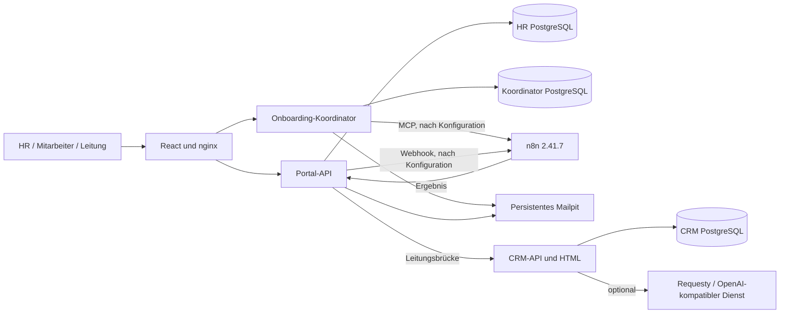

# Integration Readiness – Train Today Suite

Stand: 30.10.2026. Ziel: **READY FOR INTEGRATION REVIEW**, keine Produktionsfreigabe.

Basis des Übergabe-Branches: `de7486893f53afa2512234490e0bced3fd78cafb` von `origin/main`. Der endgültige Commit-SHA wird im Pull Request genannt. `SOURCE-MANIFEST.json` dokumentiert die SHA-256-Prüfsummen der übergebenen Dateien und des verschlüsselten Datenarchivs. Der Snapshot liegt ausschließlich unter `handover/train-today-suite`; die bestehende Anwendung im Repository-Hauptverzeichnis wurde nicht ersetzt.

## Architektur

## Funktionsstand

| Funktion | Implementierungsstand | Aktuelle Übergabeprüfung |
| --- | --- | --- |
| HR und persönliche Mitarbeiterkonten, geschützte Bereiche | IMPLEMENTED | Anmeldung und Rollen geprüft |
| Aufgaben, persönliche Zuordnung, Status, Nachweise, Historie | IMPLEMENTED | Daten wiederhergestellt, Ansichten und Fachlogik geprüft |
| Konkrete IT-/HR-Aktionen, Zugänge, Termine, Schulungsbestätigung | IMPLEMENTED | Modulprüfungen; nicht jede Schreibaktion im Restore erneut durchlaufen |
| Team, Unternehmensregeln, persönliche Zugänge | IMPLEMENTED | Quellstand und Daten enthalten; kein neuer vollständiger Klicktest aller Unterseiten |
| Direktchat und Gruppen, Gruppenerstellung nur IT | IMPLEMENTED | Historie, Mitgliedersicht, Berechtigungsflag und Fenster geprüft |
| Leitungsübersicht mit aufklappbaren Bereichen und Tortendiagramm | IMPLEMENTED | API und gerenderte Oberfläche geprüft |
| CRM-Kunden, Projekte, Aufgaben, Zeiten, Prognosen und Vertrieb | IMPLEMENTED | Login, Snapshot und Dashboard geprüft; nicht jede CRM-Aktion erneut getestet |
| CRM-Auswertung im Portal, Abwesenheiten, explizite Neuzuweisung | IMPLEMENTED | Datenbrücke und Zugriffsschutz geprüft; Schreibaktionen nicht erneut getestet |
| Lesender Projekt-Assistent mit freigegebenem CRM-Kontext | PARTIAL | Quellcode vorhanden; braucht neuen KI-Schlüssel, Anbieteraufruf im Übergabetest NOT TESTED |
| Neue KI-Aufnahme und Aufgabenplanung über n8n | PARTIAL | 14 Importe geprüft, bleiben inaktiv; neue Credentials und vollständiger Durchlauftest erforderlich |
| Reale Firmenkonten bei externen Diensten automatisch provisionieren | NOT IMPLEMENTED | Das Portal dokumentiert/freigibt Zugänge, ersetzt keine externe IAM-Verwaltung |
| Produktionsinstallation und Produktionskompatibilität | NOT TESTED | Kein VPS-Zugriff, keine produktiven Änderungen |

## API-Kompatibilitätsmatrix

| Schnittstelle | Vertrag dieser Kopie | Integrationshinweis |
| --- | --- | --- |
| `POST /api/auth/login` | `{username,password}` → `{data:{user,csrf_token}}` und Sitzungscookie | Portal-Authentifizierung; kein CRM-Bearer-Token |
| `GET /api/workspace/profile` | Rollen, Mitarbeiter-ID, Systemadmin-/Leitungsflag | Serverseitige Berechtigungen beibehalten |
| `GET /coordinator/workspace/management` | `metrics`, `plans`, `responsibleGroups`, `byAssignee` | nginx leitet `/coordinator/` an Koordinator `/api/` weiter |
| `GET /coordinator/workspace/tasks` | `{csrf,hr,systemAdmin,entries}` | Nur zulässige Aufgaben; Mitarbeiteraktionen eingeschränkt |
| `PATCH /coordinator/workspace/tasks/:case/:task` | Status + aufgabenspezifische `actionData` | Session und `X-Onboarding-CSRF`; Validierung in `task-actions.mjs` |
| `POST /api/chat/groups` | IT-berechtigte Gruppenerstellung | Mitgliedschaft und Schreibrechte im Backend prüfen |
| `GET /api/crm-leadership/overview` | CRM-Projekte, Aufgaben, Personen, Metriken und lokale Abwesenheiten | Nur Leitung; interne Brücke mit `X-Leadership-Key` |
| CRM `POST /api/login` | `{login,password}` → `{token,user}` | Getrennte CRM-Authentifizierung |
| CRM `GET /api/snapshot` | `records`, `people`, `members`, `history`, … | Bearer-Token; persönliche Sicht statt allgemeinem DB-Zugriff |
| CRM `POST /api/command` | `request_id`, `action`, objektbezogene Daten | Idempotenz, Versionen und Rollen erhalten |
| `POST /api/internal/onboarding/result` | Mitarbeiter-ID, Status und Ergebnis oder Fehlercode | Getrenntes internes Bearer-Secret, Wiederholungs-/Konfliktprüfung |

Konkrete Aktionen und Felder stehen in `onboard/backend/src/routes/`, `coordinator/server.mjs`, `coordinator/task-actions.mjs` und `crm/src/server.mjs`. Bestehende produktive Endpoints nicht parallel unter denselben Pfaden installieren. Die Bewertung ist **vorläufig**, da der vollständige aktuelle Produktionsstand nicht in dieser Übergabe ausgeführt wurde.

## Datenbank- und Migrationsmatrix

| Datenbank | Inhalt / Beziehungen | Wiederherstellung und Konflikte |
| --- | --- | --- |
| HR, PostgreSQL 17, Schema `employee_onboarding` | Mitarbeiter, Konten/Sitzungen, Jobs, Einladungen, Abteilungen, Workspace-Rechte, Zugänge, Regeln/Bestätigungen, Chat-Unterhaltungen/Mitglieder/Nachrichten, Leitungsereignisse/Abwesenheiten | `onboard.dump`; sieben versionierte Migrationen unter `onboard/database/migrations/`. Migrationsstände sind im Dump enthalten. Nicht über eine produktive HR-Datenbank restaurieren. |
| Koordinator, PostgreSQL 17 | `coordinator_cases` mit JSON-Aufgabenplan, `coordinator_events` und `coordinator_mail` mit Fall-Fremdschlüssel | `coordinator.dump`. Ein Prozess besitzt den Arbeitssatz per Advisory Lock. `hrEmployeeId` verbindet Fälle mit der separaten HR-Datenbank; kein datenbankübergreifender FK. |
| CRM, PostgreSQL 16, Schema `crm` und `trade_fair` | Records für Kunden/Projekte/Aufgaben/Zeiten, Benutzer, Mitgliedschaften, Audit, Outbox, Kern-Verarbeitung | `crm.dump`; SQL-Quellen unter `crm/sql/`. Rollen-ACLs werden wiederhergestellt. Infrastrukturpasswörter und Kontextschlüssel werden neu gesetzt. Konflikte mit vorhandenem `trade_fair` separat analysieren. |
| Mailpit SQLite | Historische lokale E-Mails | Separat unter `mailpit/`, persistentes Docker-Volume. Keine SMTP-Provider-Zugangsdaten. |

Nicht übernommen: HR-Sitzungsdaten, HR-Einladungstoken, CRM-Sitzungen/Login-Limits und ursprüngliche CRM-Kontextschlüssel. `crm_agent` erhält erneut `default_transaction_read_only=on`. Der Restore ist ein **Snapshot-Import in eine leere Datenbank**, keine Migration zwischen verschiedenen produktiven Datenständen.

## Bekannte Grenzen und Risiken

- Das öffentliche Archiv ist nur mit dem separat geteilten Passwort lesbar. Lokale Testzugänge nach Übernahme ändern; entschlüsselte Dateien und Mailverläufe nicht erneut veröffentlichen.
- Die enthaltenen Aufgaben, Kommentare und Chatgruppen dienen der simulierten Unternehmensarbeit. Historische Zählwerte ändern sich mit dem Kalenderdatum und durch neue Benutzeraktionen.
- Personen werden zwischen Portal und CRM nicht durch ein gemeinsames SSO-Konto verbunden. Die Leitungsbrücke verwendet eine ausdrücklich berechtigte CRM-Identität.
- Historische Setup-, Seed- und Regression-Skripte aus den Komponenten können Pfade oder Annahmen der ursprünglichen Installation enthalten. Nicht ungeprüft ausführen; die gemeinsame Startanleitung ist maßgeblich.
- Workflow-Import ist getestet, vollständige neue KI-/Mail-/Kern-Verarbeitung nach Credential-Konfiguration nicht. Resend-Workflow 04 kann echte E-Mails senden und bleibt inaktiv.
- Gleichzeitige Worker, doppelte Webhook-Pfade und vorhandene `trade_fair`-Tabellen sind Integrationsrisiken. Produktive WF-A/B/C/D bleiben unverändert; diese Kopie nicht an deren Outbox anschließen, bevor die Zuständigkeit geklärt ist.
- Kein Passwort-, Secret- oder Datenbanksynchronisationsdienst zwischen Juris PC und Sergiis Installation. Dies ist ein Stand vom Exportzeitpunkt.

## Empfohlene Integrationsreihenfolge

1. PR und Prüfsummen prüfen; Archivpasswort separat erhalten.
2. Ausschließlich die isolierte Installation gemäß README starten, Daten und Rollen prüfen.
3. Eigene n8n-Owner-Anmeldung und Credentials einrichten; Workflows importieren, URLs/IDs/MCP-Freigaben prüfen.
4. Einen neuen HR-Fall, Aufgabenplan, Freigabe, lokale Einladung, Mitarbeiteraktivierung und konkrete IT-Aufgabe vollständig testen.
5. CRM-Datenbrücke, Agentenkontext, Aufgaben-Neuzuweisung und Rechte testen. Externe KI nur mit vorgesehenem Providerzugang konfigurieren.
6. Produktionscode, API-Verträge und Schemas vergleichen; gezielte Migrationen und gesonderte Abnahme planen. Erst danach ein produktives Deployment separat freigeben.

## Rollback

Die Testkopie mit `python local-suite.py stop` stoppen. Ihre Volumes bleiben erhalten; bestehende Anwendungen laufen unabhängig weiter. Die Ergänzung im PR lässt sich als eigener Snapshot wieder entfernen, ohne den Root-Code zu ändern. Ein Merge oder Rollback einer produktiven Datenmigration gehört nicht zu dieser Übergabe. Für einen erneuten Restore neue leere Volumes bzw. eine andere isolierte Compose-Installation verwenden; keine produktive Datenbank leeren.
